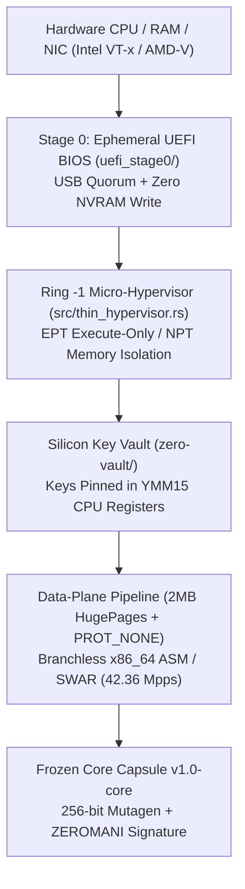
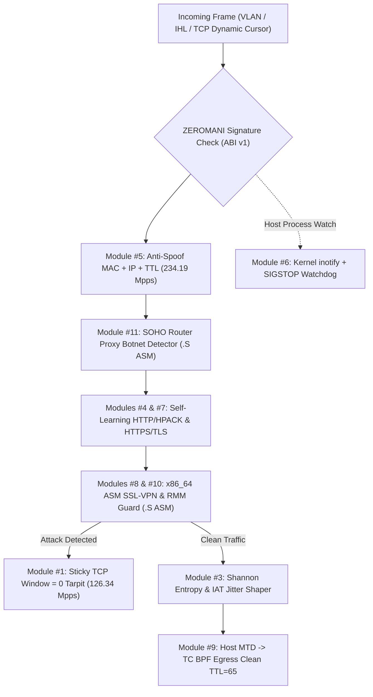

# Zero-Timing Manifesto (`v1.0-core`)

**Deterministic `no_std` Rust & `x86_64` Assembly data-plane core, Ring -1 micro-hypervisor, and 11-module plug-in ecosystem.**

## 1. Frozen Core Architecture (`v1.0-core`)

## 2. Plug-In Module Pipeline (`modules/` — 11 Modules)

* **Benchmarks & Build:** Run `make test && make clean` (see [`benchmarks/README.md`](benchmarks/README.md)).
* **License & Support:** GPL-3.0 (`LICENSE`). TON / USDT: `UQBTjCDPiQIUl73F_1f-3ArppvjdfJ7mfONIyfDZl5d9z66Z`
