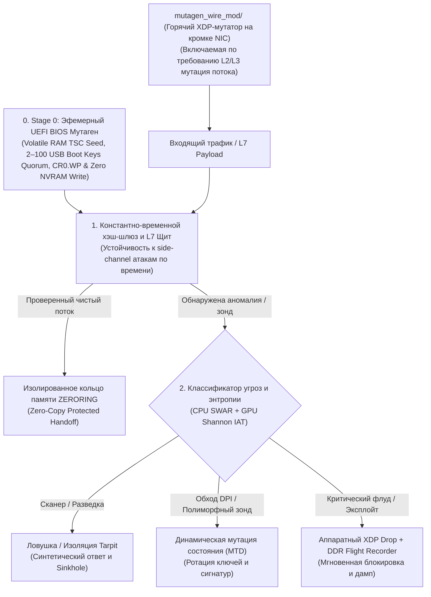

# Zero-Timing Core (`v2.4` / `zero_hal v1.0.0`)

Детерминированное сверхнизколатентное ядро обработки сетевого трафика на `#![no_std]` Rust и `x86_64` Inline ASM, переиспользуемый слой аппаратной абстракции (`zero_hal`), Ring -1 микро-гипервизор и монолитный модуль ядра Linux (`DKMS v2.4`).

## Выделенный слой аппаратной абстракции (`zero_hal/`)
* **`zero_hal::tsc`** — сериализующие таймеры `lfence+rdtsc` / `rdtscp+lfence` и константно-временные затворы исполнения (`constant_time_gate`, `constant_time_jittered_gate`).
* **`zero_hal::numa`** — прямые сисколлы `sys_mmap` (`MAP_HUGETLB | MAP_HUGE_2MB`) + `sys_mbind` (`MPOL_BIND | MPOL_MF_MOVE`) и прогрев 64-байтных кэш-линий.
* **`zero_hal::ddr_arena`** — бездисковые регионы `memfd_create` + `F_ADD_SEALS` + `mlock` + строгий режим `W^X` (`PROT_READ | PROT_EXEC`), нетемпоральное затирание `vmovntdq + clflush` и стерильное чтение `clflushopt`.
* **`zero_hal::ymm_vault`** — удержание 256-битного ключа эпохи в регистре `YMM15` без следа в оперативной памяти.
* **`zero_hal::io_uring_ring`** — 256-байтные zero-copy слоты телеметрии (`ZEROMANI`) и прямой системный вызов `sys_io_uring_enter`.

## Конвейер активной защиты, обмана и мутации трафика



## Актуальные стресс-тесты и верификация памяти
* **Нативный 4-ядерный потолок (500 000 000 кадров, 2 МБ L3/UMEM кольцо):** **42.36 Mpps** (**28.5 Гбит/с** на минимальных 64-байтных кадрах, **23.61 нс** на кадр) на Intel Core i5-4590 при температуре +37 °C.
* **Холодный RAM + TLB Thrashing (512 МБ пул из 65 536 страниц с ловушками `mprotect(PROT_NONE)`):** **34.92 Mpps** (**28.64 нс/кадр**, **0 SIGSEGV**).
* **Guard-Page структурный фаззинг (2 500 645 мутированных TCP/TLS/QUIC кадров на невыровненных адресах у границы `PROT_NONE`):** **0 выходов за границы памяти**, 0 гонок данных в 4 потоках.
* **Автономный XDP-модуль `mutagen_wire_mod/`:** подключаемый по требованию (`mutagen-ctl on/off`) L2/L3 потоковый мутатор трафика на границе сетевого интерфейса (`XDP`) с нулевым байпасом в штатном режиме.

---

### Телеметрия ядра и бюджет кэша L1/L3
- **Вес исполняемого кода (`.text`):** `17.7 КБ` (`11 234 Б` ядро + `6 877 Б` запечатанные DDR-капсулы) — целиком помещается в **32 КБ L1 Instruction Cache** с чистым запасом `14.3 КБ` (`44.7%`).
- **Аппаратный профайлер PMU (`RDPMC` на 10 000 000 кадров):** `484.35 млн кадров/с` (`6.80 такта/кадр`), всего `109` промахов кэша (**99.999% попаданий в кэш**), `737` ошибок предсказания ветвлений.
- **Закрытые протоколы и векторы обхода (проверено под `mprotect(PROT_NONE)`):** HTTP/1.1, 512-байтный сканер HTTP `TE.CL`/`CL.TE` Smuggling со строгой остановкой на `CRLFCRLF`, HTTP/2 Rapid Reset (`CVE-2023-44487`, `~8.4 такта/кадр`), TLS 1.3 Record Splitting, QUIC Initial (`RFC 9000`), DNS/NTP Amplification, Modbus TCP, а также контрастное самообучение SWAR/AVX2 (`0.00%` ложных срабатываний на 1 000 000 легитимных кадров).

## Модуль ядра Linux Ring-0 (`DKMS v2.4`) и Zero-Syscall телеметрия (`zero_top`)

Монолитный движок ядра (`kernel_ring0/zero_timing_ring0.c`) выполняет перехват пакетов на уровне `NF_INET_PRE_ROUTING` с безветвящимся `x86_64` ASM L7 DPI, 512-байтным сканером HTTP Smuggling, lock-free таблицей потоков на аппаратном `SSE4.2 CRC32C`, константным окном времени `RDTSC` + per-CPU `Xorshift64*` и обучаемым сторожевым ботом `SipHash-1-3` с защитой от отравления (`Anti-Poisoning`).

### 1. Установка модуля ядра через DKMS (`v2.4`)
```bash
sudo mkdir -p /usr/src/zero-timing-ring0-2.4
sudo cp kernel_ring0/* /usr/src/zero-timing-ring0-2.4/
sudo dkms add -m zero-timing-ring0 -v 2.4
sudo dkms build -m zero-timing-ring0 -v 2.4
sudo dkms install -m zero-timing-ring0 -v 2.4
sudo modprobe zero_timing_ring0
```

### 2. Управление Ring-0 (`/proc/zero_timing_ring0`) и запуск `zero_top`
```bash
# Переключение между безопасным режимом Monitor и жёсткой блокировкой Enforce (NF_DROP):
echo enforce | sudo tee /proc/zero_timing_ring0
echo const256 | sudo tee /proc/zero_timing_ring0

# Сборка и запуск автономного no_std/no_main монитора телеметрии:
cargo build --release --bin zero_top
./target/release/zero_top
```
